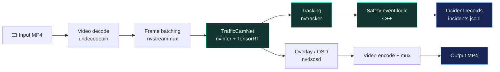
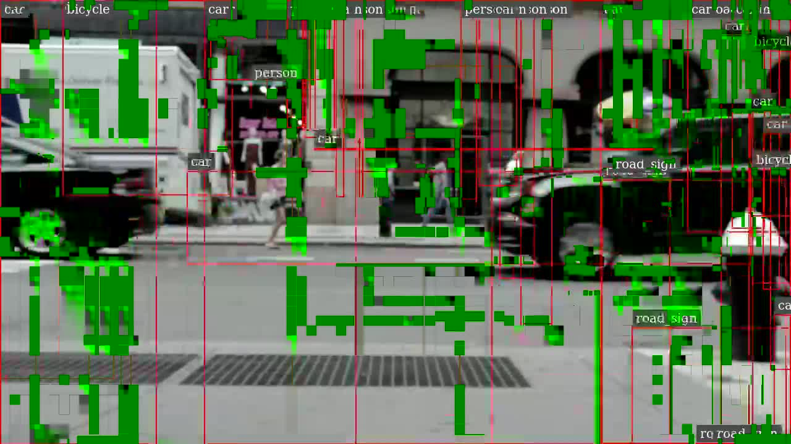
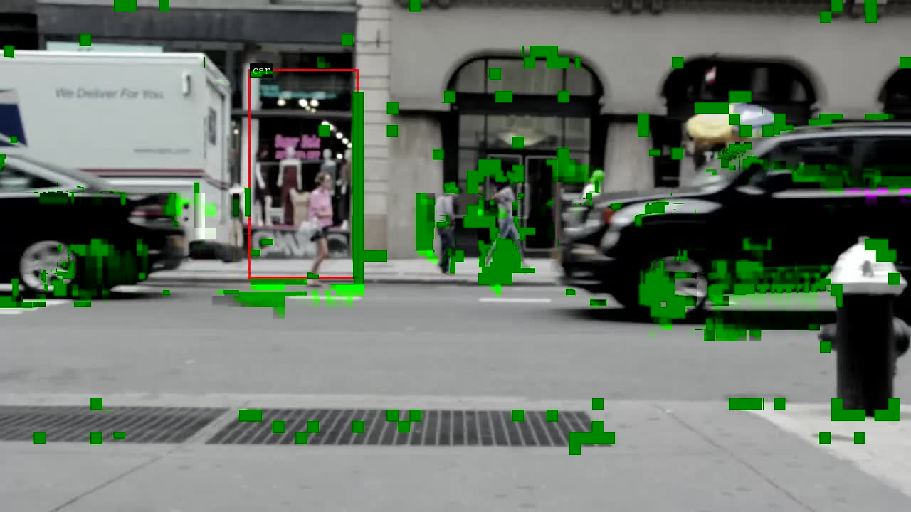

<div align="center">


# 🛡️ Workplace Safety Sentinel

### Edge AI · Video Analytics · Safety Event Prototyping

**An experimental computer-vision pipeline exploring person detection, object tracking, and restricted-zone entry events with NVIDIA DeepStream and TensorRT.**

<p>


</p>

<p>


</p>

[Overview](#-overview) · [Architecture](#-architecture) · [Tech Stack](#-technology-stack) · [Build & Run](#-build-and-run) · [Evidence](#-evidence--validation) · [Roadmap](#-roadmap)

</div>

---

## ✦ Overview

**Workplace Safety Sentinel** is an experimental edge-AI video analytics project created for the **CraftifAI PipeGen Hackathon — Participant ID CRA004**.

The custom C++ application was compiled and executed inside an NVIDIA DeepStream container. In the recorded test, the pipeline processed a sample video, generated an MP4, and wrote 13 JSON Lines (`.jsonl`) incident records. The JSONL file was checked for valid syntax and required fields.

> [!IMPORTANT]
> **This is not a validated workplace safety system.** Detection overlays were visibly incorrect. The 13 emitted event records have not been independently verified as genuine restricted-zone entries. Do not use this prototype to make safety-critical decisions.

### Project snapshot

| Item | Current result |
|---|---|
| Runtime | NVIDIA DeepStream 7.1 container |
| Model | TrafficCamNet / ResNet-18 ONNX |
| Inference | TensorRT engine generated/loaded by DeepStream |
| Application | Custom C++17 GStreamer/DeepStream pipeline |
| Test input | 1920 × 1080, 25 FPS sample video |
| Output video | MP4 generated successfully; about 25 MB locally |
| Event output | 13 parseable JSONL records |
| Detection quality | **Not validated** — overlays were incorrect |
| FPS / latency | Not measured |

## ✨ Capabilities & validation status

| Capability | Status | Notes |
|---|:---:|---|
| Video input and decoding | ✅ Executed | Sample MP4 processed in test container |
| TrafficCamNet inference | 🟡 Experimental | TensorRT engine creation/loading observed |
| Detection visualization | ❌ Needs work | Bounding-box overlays were incorrect |
| Object tracking | 🟡 Prototype | Tracking quality not visually validated |
| Restricted-zone event logic | 🟡 Prototype | Events emitted, correctness unverified |
| JSON Lines output | ✅ Format checked | 13 records parsed; required fields present |
| FPS / latency benchmark | ⚪ Not measured | No performance claim |
| PipeGen Pipeline IR evidence | ⚪ Not verified | Must be captured from an actual run |

## 🧭 Architecture



<sub>Conceptual pipeline view. Output quality and exact runtime behavior still require validation.</sub>

## 🧰 Technology stack

<div align="center">
<a href="https://developer.nvidia.com/deepstream-sdk"></a>
<a href="https://developer.nvidia.com/tensorrt"></a>
<a href="https://gstreamer.freedesktop.org/"></a>
<a href="https://isocpp.org/"></a>
<a href="https://www.docker.com/"></a>
<a href="https://ubuntu.com/"></a>
</div>

| Layer | Technology |
|---|---|
| Application | C++17 |
| Video pipeline | GStreamer, NVIDIA DeepStream 7.1 |
| Inference | NVIDIA TensorRT |
| Detection model | TrafficCamNet, ResNet-18 ONNX |
| Tracking | DeepStream `nvtracker` |
| Metadata | JSON Lines (`.jsonl`) |
| Container runtime | Docker + NVIDIA Container Toolkit |
| Development host | Windows 11 + Ubuntu on WSL2 |
| Tested GPU | NVIDIA GeForce RTX 3050, 6 GB |

## 🖥️ Tested environment

- **Host:** Windows 11 with Ubuntu on WSL2
- **GPU:** NVIDIA GeForce RTX 3050 (6 GB)
- **Container:** `craftifai-amd64-v3`
- **Image:** `craftifaidocker/deepstream:7.1-amd64-v3`
- **DeepStream:** 7.1
- **Model:** `resnet18_trafficcamnet_pruned.onnx`
- **Observed model input:** `[batch, 3, 544, 960]`

These are environment details, not an accuracy or performance benchmark.

## 📁 Repository structure

```text
CraftifAIHackathon_CRA004/
├── README.md
├── .gitignore
├── src/
│   └── safety_sentinel.cpp
├── config/
│   ├── trafficcamnet_detector.yml
│   └── trafficcamnet_infer_post.txt
└── evidence/
    ├── trafficcamnet_frame.jpg
    ├── trafficcamnet_post_frame.jpg
    └── incidents.jsonl
```

| Path | Purpose |
|---|---|
| `src/safety_sentinel.cpp` | Custom C++ DeepStream/GStreamer application |
| `config/trafficcamnet_detector.yml` | Detector post-processing configuration |
| `config/trafficcamnet_infer_post.txt` | Inference/post-processing test configuration |
| `evidence/trafficcamnet_frame.jpg` | Earlier frame used for visual inspection |
| `evidence/trafficcamnet_post_frame.jpg` | Frame showing the visualization issue |
| `evidence/incidents.jsonl` | Structured records from the C++ test run |

The generated `evidence/safety_sentinel_output.mp4` remains a local artifact and is ignored by Git (`*.mp4`). The input video, model, and TensorRT engine are not included.

## 🚀 Build and run

> [!NOTE]
> This is not yet a one-command portable installation. The commands below reflect the tested container setup; paths and dependencies may differ elsewhere.

### 1. Prerequisites

- NVIDIA GPU and compatible driver
- Docker configured for GPU access
- Compatible NVIDIA DeepStream 7.1 container
- Input video accessible inside the container
- TrafficCamNet ONNX model and DeepStream libraries

Check the container:

```bash
docker ps --filter name=craftifai-amd64-v3
```

### 2. Compile the application

From the repository root in Ubuntu/WSL2:

```bash
docker cp src/safety_sentinel.cpp craftifai-amd64-v3:/tmp/safety_sentinel.cpp
```

Compile inside the container:

```bash
docker exec craftifai-amd64-v3 bash -lc '
g++ -std=c++17 -Wall -Wextra \
  -I/opt/nvidia/deepstream/deepstream-7.1/sources/includes \
  /tmp/safety_sentinel.cpp \
  -o /tmp/safety_sentinel \
  $(pkg-config --cflags --libs gstreamer-1.0) \
  -L/opt/nvidia/deepstream/deepstream-7.1/lib \
  -lnvdsgst_meta -lnvds_meta
'
```

### 3. Run on a video

The application accepts an input video path and an output video path. Both must be accessible inside the container.

```bash
docker exec craftifai-amd64-v3 bash -lc '
export LD_LIBRARY_PATH=/opt/nvidia/deepstream/deepstream-7.1/lib:$LD_LIBRARY_PATH
cd /tmp
rm -f incidents.jsonl
./safety_sentinel \
  /path/inside/container/input.mp4 \
  /tmp/safety_sentinel_output.mp4
'
```

Replace `/path/inside/container/input.mp4` with a real video path in your environment. The original development-machine path is not portable.

Expected artifacts after a completed run:

- `/tmp/safety_sentinel_output.mp4`
- `/tmp/incidents.jsonl`

A completed run proves that processing reached completion and produced files; it does **not** prove that detections or events are correct.

### 4. Copy and validate event output

```bash
docker cp craftifai-amd64-v3:/tmp/incidents.jsonl evidence/incidents.jsonl
```

Validate JSON syntax and required fields:

```bash
python3 -c 'import json; from pathlib import Path; p=Path("evidence/incidents.jsonl"); rows=[json.loads(line) for line in p.read_text().splitlines()]; print(f"Valid JSON records: {len(rows)}"); print("Event types:", sorted({r["event"] for r in rows})); print("Required fields present:", all({"event","frame_num","track_id","confidence","bbox"} <= r.keys() for r in rows))'
```

The recorded test produced **13 parseable records** containing `event`, `frame_num`, `track_id`, `confidence`, and `bbox`. This validates file structure only—not event correctness.

## 🧪 Evidence & validation

| Check | Result |
|---|---|
| GPU visible in development environment | ✅ Passed |
| DeepStream container available | ✅ Passed |
| C++ application compiled | ✅ Passed |
| TensorRT engine created/loaded during run | ✅ Observed |
| Pipeline reached end-of-stream | ✅ Passed |
| Output MP4 created | ✅ Passed |
| JSONL syntax and required fields | ✅ Passed for 13 records |
| Bounding boxes visually correct | ❌ Failed; debugging required |
| Tracking quality | ⚠️ Not visually validated |
| Restricted-zone event correctness | ⚠️ Not independently validated |
| FPS / latency benchmark | ⚪ Not measured |
| PipeGen Pipeline IR export/screenshot | ⚪ Not verified |

### Visual evidence

<div align="center">


</div>

<sub>Diagnostic screenshots only; they are not proof of accurate detections.</sub>

### Example event record

```json
{
  "event": "restricted_zone_entry",
  "frame_num": 20,
  "track_id": 1,
  "confidence": 0.408365,
  "bbox": {
    "left": 880.488,
    "top": 0,
    "width": 457.461,
    "height": 881.614
  }
}
```

This illustrates the emitted schema. It does not establish that a real restricted-zone entry occurred.

## 🐛 Known limitations

1. **Incorrect overlays:** output frames showed scattered green blocks and incorrect/overlapping bounding boxes.
2. **Post-processing needs validation:** preprocessing, tensor layout, box decoding, class mapping, labels, thresholds, and plugin configuration must match the model.
3. **Events are not ground-truth validated:** repeated records may reflect detection or tracker instability rather than distinct real entries.
4. **Test footage is not workplace footage:** the sample was street video in monochrome infrared mode.
5. **No performance figures:** FPS and latency have not been measured.
6. **PipeGen evidence is incomplete:** a finalized requirement flow is not proof that the custom C++ pipeline ran end-to-end through PipeGen or that a TensorRT speed report exists.

## 🗺️ Roadmap

- [ ] Correct and visually validate TrafficCamNet post-processing.
- [ ] Compare decoded boxes against known reference frames.
- [ ] Validate stable tracking and identity persistence.
- [ ] Define a restricted-zone polygon in frame coordinates.
- [ ] Test entry logic against labeled scenarios.
- [ ] Add timestamps and useful zone/object context to event records.
- [ ] Create a repeatable setup and run script.
- [ ] Verify the custom source in PipeGen's supported workflow.
- [ ] Capture genuine Pipeline IR and TensorRT performance evidence.
- [ ] Measure FPS and latency under a repeatable test setup.
- [ ] Test on appropriate workplace footage with permission.

## 🔐 Safety & responsible use

- Process video only when you have permission and a lawful basis.
- Treat detections as fallible and require human review.
- Do not use this prototype as the sole basis for safety-critical decisions.
- Apply appropriate privacy, access-control, retention, and workplace-policy safeguards before deployment.

## 🏁 Hackathon details

<div align="center">

**CraftifAI PipeGen Hackathon**  
**Project:** Workplace Safety Sentinel  
**Participant ID:** CRA004

<a href="https://github.com/vinaybabannavar-create/CraftifAIHackathon_CRA004">

</a>

<br/><br/>

**Build responsibly. Validate honestly. Improve continuously.**

<sub>Made for experimentation with edge AI, video analytics, and safety-event workflows.</sub>

</div>
