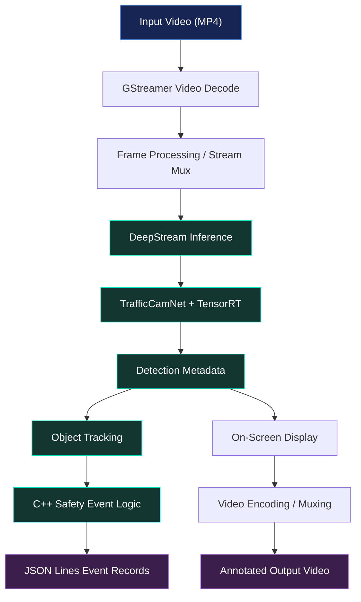
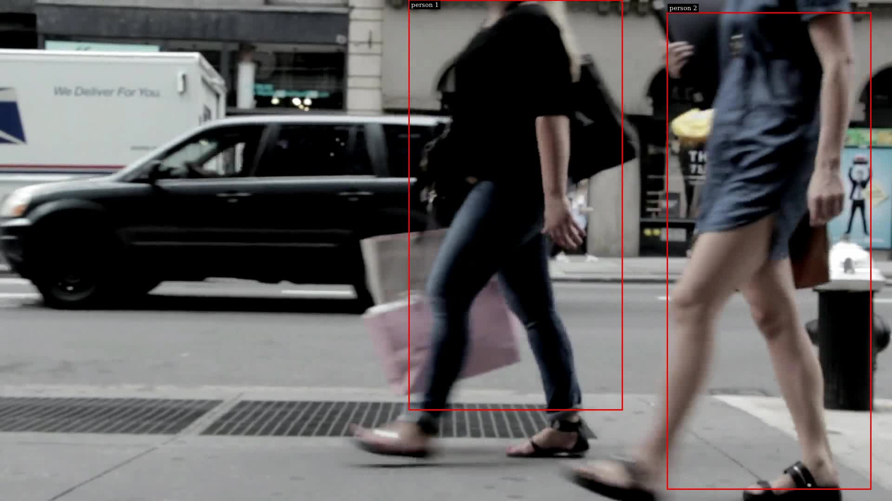

# 🛡️ Workplace Safety Sentinel
### Edge AI · Intelligent Video Analytics · Safety Event Prototyping

<p align="center">
  
  
  
  
  
  
</p>

<p align="center">
  <strong>An experimental edge-AI pipeline for person detection, object tracking, video visualization, and restricted-zone safety-event prototyping.</strong>
</p>

<p align="center">
  <a href="#-overview">Overview</a> ·
  <a href="#-features">Features</a> ·
  <a href="#-technology-stack">Tech Stack</a> ·
  <a href="#-architecture">Architecture</a> ·
  <a href="#-installation-and-setup">Setup</a> ·
  <a href="#-build-and-run">Build & Run</a> ·
  <a href="#-evidence-and-validation">Evidence</a> ·
  <a href="#-roadmap">Roadmap</a>
</p>

---

## 📌 Table of Contents

1. [Overview](#-overview)
2. [Problem Statement](#-problem-statement)
3. [Project Objectives](#-project-objectives)
4. [Features](#-features)
5. [Technology Stack](#-technology-stack)
6. [System Architecture](#-system-architecture)
7. [Project Structure](#-project-structure)
8. [Prerequisites](#-prerequisites)
9. [Installation and Setup](#-installation-and-setup)
10. [Build and Run](#-build-and-run)
11. [Configuration](#-configuration)
12. [Output and Event Schema](#-output-and-event-schema)
13. [Evidence and Validation](#-evidence-and-validation)
14. [UI and Design Status](#-ui-and-design-status)
15. [Troubleshooting](#-troubleshooting)
16. [Limitations](#-limitations)
17. [Future Enhancements](#-future-enhancements)
18. [Safety, Privacy, and Responsible Use](#-safety-privacy-and-responsible-use)
19. [Hackathon Information](#-hackathon-information)
20. [Author and Repository](#-author-and-repository)

---

## ✨ Overview

**Workplace Safety Sentinel** is an experimental computer-vision project developed for the **CraftifAI PipeGen Hackathon**, under Participant ID **CRA004**.

The project explores how edge-AI video analytics can be used to process video streams, detect objects, track detected entities, visualize inference results, and generate structured records for potential safety events.

The application is implemented in **C++17** and uses NVIDIA DeepStream, GStreamer, and TensorRT for video processing and inference.

The current prototype has been compiled and executed inside an NVIDIA DeepStream 7.1 Docker container. A sample video was processed to completion, an output video was generated, and structured JSON Lines event records were emitted.

> [!IMPORTANT]
> **This is an experimental prototype, not a validated workplace safety product.** Person detections have been visible in some frames, but bounding-box accuracy, tracking stability, and restricted-zone event correctness have not been comprehensively validated. The project must not be used as the sole basis for safety-critical decisions.

### Project Snapshot

| Property | Details |
|---|---|
| Project name | Workplace Safety Sentinel |
| Participant ID | CRA004 |
| Category | Edge AI and video analytics |
| Primary language | C++17 |
| Video framework | GStreamer |
| AI inference framework | NVIDIA DeepStream |
| Inference engine | NVIDIA TensorRT |
| Detection model | TrafficCamNet / ResNet-18 ONNX |
| Runtime environment | Docker container |
| Development environment | Windows 11 + Ubuntu on WSL2 |
| GPU used during development | NVIDIA GeForce RTX 3050, 6 GB |
| Event output format | JSON Lines (`.jsonl`) |
| Frontend dashboard | Not implemented in the current prototype |
| Detection accuracy | Requires further validation |
| Performance benchmark | Not measured |

---

## 🎯 Problem Statement

Workplace monitoring may involve reviewing video footage to identify people, observe movement, and investigate potentially unsafe situations. Manual review can be time-consuming, while automated video analytics can help organize visual information for human review.

The challenge is to explore an edge-AI pipeline capable of processing video locally within a configured inference environment and producing useful visual and structured outputs.

Workplace Safety Sentinel investigates this workflow using NVIDIA's video analytics ecosystem.

The prototype does not claim to solve workplace safety monitoring completely. Instead, it establishes an experimental foundation for detection, tracking, event generation, and future validation.

## 🎯 Project Objectives

- Process video input using a GStreamer-based pipeline.
- Integrate a TrafficCamNet model through NVIDIA DeepStream.
- Execute inference using TensorRT.
- Explore object tracking and safety-event logic.
- Produce an annotated video for visual inspection.
- Emit structured JSON Lines records for downstream analysis.
- Maintain a reproducible development workflow using Docker.
- Investigate the integration of custom C++ applications with an edge-AI development workflow.
- Identify limitations requiring further testing before real-world use.

---

## 🚀 Features

### 1. Video Input and Processing

The application accepts an input video path and an output video path. The input is decoded and processed through a configured video pipeline.

**Current status:** A sample MP4 was processed to end-of-stream in the tested container.

### 2. AI-Based Object Detection

The pipeline integrates TrafficCamNet, based on a ResNet-18 ONNX model, through NVIDIA DeepStream inference components.

TensorRT is used to generate or load an inference engine in the tested environment.

**Current status:** Inference execution was observed, and person bounding boxes were visible in at least one inspected frame. Detection quality remains under investigation.

### 3. Object Tracking

The pipeline includes DeepStream tracking components intended to maintain object identities across frames.

**Current status:** Tracking is part of the prototype, but identity persistence and tracking quality have not been comprehensively validated.

### 4. Video Visualization

The pipeline includes an on-screen display stage for visualizing inference metadata on processed frames.

**Current status:** Annotated output has been generated. Some frames showed incorrect or oversized bounding boxes, so visualization must be treated as diagnostic evidence rather than proof of accurate detection.

### 5. Safety Event Prototyping

The C++ application contains event-processing logic intended to emit records for potential restricted-zone entry events.

**Current status:** Event records are emitted, but their correspondence to genuine restricted-zone entries has not been independently verified.

### 6. Structured Event Logging

The application writes JSON Lines records that can be inspected or consumed by later analysis tools.

**Current status:** JSONL output has been checked for valid JSON syntax and expected fields in the documented test run.

### 7. Containerized Development

Docker provides the NVIDIA DeepStream runtime used for compilation and execution.

**Benefit:** The project can be developed against a defined DeepStream environment rather than relying entirely on host-level library installation.

---

## 🧰 Technology Stack

The following technologies are used or form part of the tested development environment.

| Layer | Technology | Purpose |
|---|---|---|
| Application | C++17 | Pipeline orchestration and event-processing logic |
| Video processing | GStreamer | Video decoding, pipeline elements, and media handling |
| AI video analytics | NVIDIA DeepStream 7.1 | Inference and metadata integration |
| Inference acceleration | NVIDIA TensorRT | Model engine generation/loading and inference |
| Detection model | TrafficCamNet / ResNet-18 ONNX | Object detection |
| Tracking | DeepStream `nvtracker` | Object-tracking component |
| Visualization | DeepStream `nvdsosd` | On-screen display of metadata |
| Metadata | JSON Lines | Structured event output |
| Containerization | Docker | Isolated runtime environment |
| GPU access | NVIDIA Container Toolkit | GPU access from supported containers |
| Development OS | Ubuntu on WSL2 | Development and command-line workflow |
| Host OS | Windows 11 | Development machine operating system |
| Source control | Git and GitHub | Version control and project hosting |

### Technology References

- [NVIDIA DeepStream SDK](https://developer.nvidia.com/deepstream-sdk)
- [NVIDIA TensorRT](https://developer.nvidia.com/tensorrt)
- [GStreamer](https://gstreamer.freedesktop.org/)
- [C++](https://isocpp.org/)
- [Docker](https://www.docker.com/)
- [Ubuntu](https://ubuntu.com/)
- [Git](https://git-scm.com/)
- [GitHub](https://github.com/)

### Why These Technologies?

**C++17:** Provides the application layer for working with DeepStream metadata and GStreamer pipeline elements.

**GStreamer:** Supplies the multimedia pipeline used to decode, process, and produce video.

**NVIDIA DeepStream:** Provides components for AI video analytics, inference integration, tracking, and metadata handling.

**TensorRT:** Provides an inference runtime optimized for supported NVIDIA hardware.

**Docker:** Helps keep the development environment consistent with the tested DeepStream installation.

**JSON Lines:** Stores one structured event record per line, making the output convenient to inspect and process programmatically.

---

## 🏗️ System Architecture

The following diagram describes the intended processing flow. It is a conceptual architecture diagram, not a claim that every stage has passed independent functional validation.



### Architecture Components

| Component | Responsibility |
|---|---|
| Input source | Supplies the video file |
| Video decoder | Converts encoded video into frames |
| Stream processing | Prepares frames for downstream pipeline elements |
| Inference component | Runs the configured object-detection model |
| TensorRT engine | Executes inference in the supported runtime |
| Detection metadata | Carries inference results through the pipeline |
| Tracker | Attempts to associate objects across frames |
| Safety-event logic | Evaluates metadata for potential events |
| On-screen display | Draws visual annotations |
| Video output | Produces a processed video file |
| Event output | Stores structured event records in JSONL format |

---

## 📁 Project Structure

The repository contains the application source, configuration files, and diagnostic evidence.

```text
CraftifAIHackathon_CRA004/
├── README.md
├── .gitignore
├── src/
│   └── safety_sentinel.cpp
├── config/
│   ├── config_infer_primary_batch1.txt
│   ├── trafficcamnet_detector.yml
│   └── trafficcamnet_infer_post.txt
└── evidence/
    ├── trafficcamnet_frame.jpg
    ├── trafficcamnet_post_frame.jpg
    ├── safety_sentinel_frame20.jpg
    ├── safety_sentinel_check.jpg
    ├── safety_sentinel_parser_test2_frame.jpg
    └── incidents.jsonl
```

> The list above describes the expected core files and known evidence files. Confirm the actual contents of the repository before assuming every listed file is present in a particular clone.

### Important Files

| File | Purpose |
|---|---|
| `README.md` | Project documentation, setup, architecture, and validation notes |
| `src/safety_sentinel.cpp` | Custom C++ application and video-pipeline logic |
| `config/config_infer_primary_batch1.txt` | Primary inference configuration used by the current C++ pipeline |
| `config/trafficcamnet_detector.yml` | Additional detector configuration used for experimentation |
| `config/trafficcamnet_infer_post.txt` | Additional inference/post-processing configuration |
| `evidence/trafficcamnet_frame.jpg` | Earlier diagnostic frame |
| `evidence/trafficcamnet_post_frame.jpg` | Earlier diagnostic frame showing visualization problems |
| `evidence/safety_sentinel_frame20.jpg` | Newer diagnostic frame in which person boxes were visible |
| `evidence/safety_sentinel_check.jpg` | Diagnostic frame from a test run |
| `evidence/safety_sentinel_parser_test2_frame.jpg` | Diagnostic frame from a parser-configuration test |
| `evidence/incidents.jsonl` | Structured event records from an earlier test |

### Generated Files

Generated videos, TensorRT engines, temporary logs, and other runtime artifacts are not necessarily included in Git.

The repository's `.gitignore` excludes MP4 files and model-engine files. This avoids committing large generated artifacts and machine-specific binaries by default.

The original input video and the model weights are not bundled with this repository.

---

## 💻 Prerequisites

The following requirements apply to the tested development workflow.

### Hardware

- NVIDIA GPU supported by the selected NVIDIA driver and DeepStream environment.
- Sufficient GPU memory for the configured model and inference pipeline.
- Adequate disk space for source files, model files, generated engines, and video outputs.

### Software

- Windows 11 with Ubuntu on WSL2, or a compatible Linux development environment.
- Docker configured to run the selected NVIDIA container.
- NVIDIA GPU access configured for the container.
- NVIDIA DeepStream 7.1 container.
- C++ compiler supporting C++17.
- GStreamer development libraries and `pkg-config`.
- TrafficCamNet ONNX model and required labels.
- A sample video accessible inside the container.
- Git for cloning and version control.

### Tested Development Environment

| Component | Tested configuration |
|---|---|
| Host | Windows 11 + Ubuntu on WSL2 |
| GPU | NVIDIA GeForce RTX 3050, 6 GB |
| Container | `craftifai-amd64-v3` |
| Container image | `craftifaidocker/deepstream:7.1-amd64-v3` |
| DeepStream | 7.1 |
| Model | `resnet18_trafficcamnet_pruned.onnx` |
| Observed model input | `[batch, 3, 544, 960]` |

These details describe the development environment, not a portable installation guarantee or a performance benchmark.

---

## 📥 Installation and Setup

### Step 1 — Clone the repository

Open an Ubuntu/WSL2 terminal:

```bash
git clone https://github.com/vinaybabannavar-create/CraftifAIHackathon_CRA004.git
```

Move into the repository:

```bash
cd CraftifAIHackathon_CRA004
```

### Step 2 — Inspect the repository

Check the current branch and working-tree status:

```bash
git status --short --branch
```

Review the tracked project files:

```bash
git ls-files
```

### Step 3 — Check Docker

Confirm that the tested container is available:

```bash
docker ps --filter name=craftifai-amd64-v3
```

If the container is not running, start the existing container according to your local Docker setup. The exact startup command depends on how the container was originally created.

### Step 4 — Check DeepStream inside the container

```bash
docker exec craftifai-amd64-v3 bash -lc 'ls /opt/nvidia/deepstream/deepstream-7.1'
```

This checks the expected DeepStream installation directory.

### Step 5 — Verify the model and labels

The inference configuration currently refers to environment-specific paths:

```text
/opt/nvidia/deepstream/deepstream-7.1/samples/models/Primary_Detector/resnet18_trafficcamnet_pruned.onnx
/opt/nvidia/deepstream/deepstream-7.1/samples/models/Primary_Detector/labels.txt
```

Verify that the files exist in the selected container:

```bash
docker exec craftifai-amd64-v3 bash -lc 'ls -l /opt/nvidia/deepstream/deepstream-7.1/samples/models/Primary_Detector/'
```

If the files are missing, install or mount the required model assets before running the application.

---

## 🔨 Build and Run

The commands below reflect the tested container-based development workflow. The project is not yet a portable, one-command installation.

### Step 1 — Copy the C++ source into the container

From the repository root:

```bash
docker cp src/safety_sentinel.cpp craftifai-amd64-v3:/tmp/safety_sentinel.cpp
```

### Step 2 — Compile the application

Run the following command:

```bash
docker exec craftifai-amd64-v3 bash -lc 'g++ -std=c++17 -Wall -Wextra -I/opt/nvidia/deepstream/deepstream-7.1/sources/includes /tmp/safety_sentinel.cpp -o /tmp/safety_sentinel $(pkg-config --cflags --libs gstreamer-1.0) -L/opt/nvidia/deepstream/deepstream-7.1/lib -lnvdsgst_meta -lnvds_meta'
```

A successful command should return to the shell without compiler errors.

This compile command was successful in the documented development container. Other environments may require different include paths or libraries.

### Step 3 — Verify the configuration

The current C++ application loads:

```text
config/config_infer_primary_batch1.txt
```

The application uses a relative path for this file. Therefore, the process must run from the repository root, or the source must be updated to use a reliably resolved configuration path.

The configuration also contains absolute paths for the ONNX model, labels, and TensorRT engine. Those paths must be valid inside the runtime container.

### Step 4 — Select a video

Provide an input video path that exists inside the container.

A sample path used during development was:

```text
/home/preet/sentinelai/videos/854100-hd_1920_1080_25fps.mp4
```

This path belongs to the original development environment. It is not available automatically to another user.

Check that the selected video exists:

```bash
docker exec craftifai-amd64-v3 bash -lc 'ls -lh /home/preet/sentinelai/videos/854100-hd_1920_1080_25fps.mp4'
```

If you use a different video, substitute its actual container path.

### Step 5 — Run the pipeline

The project directory was available inside the tested container at:

```text
/home/preet/CraftifAIHackathon_TEMP
```

Using that mounted project directory, run:

```bash
docker exec craftifai-amd64-v3 bash -lc 'export LD_LIBRARY_PATH=/opt/nvidia/deepstream/deepstream-7.1/lib:$LD_LIBRARY_PATH && cd /home/preet/CraftifAIHackathon_TEMP && /tmp/safety_sentinel /home/preet/sentinelai/videos/854100-hd_1920_1080_25fps.mp4 /tmp/safety_sentinel_output.mp4'
```

For a different environment, replace the project directory and input video path with the correct paths.

**Environment note:** The container path above is historical and has not been re-verified in the current session because `craftifai-amd64-v3` is not running. Confirm the container and mounted paths before using the command.

**Important:** The application writes `incidents.jsonl` in its current working directory. The command above runs from the project directory, so it may create or modify a root-level `incidents.jsonl`. Back up any existing file before rerunning if you need to preserve its records.

The output video is requested at:

```text
/tmp/safety_sentinel_output.mp4
```

### Step 6 — Check the output video

```bash
docker exec craftifai-amd64-v3 bash -lc 'ls -lh /tmp/safety_sentinel_output.mp4'
```

A generated MP4 confirms that an output file exists. Visual inspection is still required to determine whether the annotations are correct.

### Step 7 — Inspect the event output

Check whether the runtime created an event file in the project directory:

```bash
docker exec craftifai-amd64-v3 bash -lc 'ls -lh /home/preet/CraftifAIHackathon_TEMP/incidents.jsonl'
```

If present, inspect a few records:

```bash
docker exec craftifai-amd64-v3 bash -lc 'head -n 5 /home/preet/CraftifAIHackathon_TEMP/incidents.jsonl'
```

The event file should be treated as experimental output until its records have been checked against the corresponding video frames.

### Step 8 — Validate JSON Lines syntax

From the repository root, validate the generated root-level file:

```bash
python3 -c 'import json; from pathlib import Path; p=Path("incidents.jsonl"); rows=[json.loads(line) for line in p.read_text().splitlines() if line.strip()]; required={"event","frame_num","track_id","confidence","bbox"}; print("Valid JSON records:", len(rows)); print("Required fields present:", all(required.issubset(r) for r in rows)); print("Event types:", sorted({r.get("event") for r in rows}))'
```

This checks JSON syntax and the presence of the expected fields. It does not validate the accuracy of a detection or event.

---

## ⚙️ Configuration

### Primary inference configuration

File:

```text
config/config_infer_primary_batch1.txt
```

This file configures the primary detector used by the current C++ application.

The key settings include:

| Setting | Purpose |
|---|---|
| `gpu-id` | Selects the GPU |
| `onnx-file` | Path to the ONNX model |
| `model-engine-file` | TensorRT engine path |
| `labelfile-path` | Path to the class-label file |
| `batch-size` | Inference batch size |
| `process-mode` | Configures the inference processing mode |
| `network-mode` | Configures the network precision mode |
| `num-detected-classes` | Configured number of detector classes |
| `gie-unique-id` | Identifier for the inference component |
| `net-scale-factor` | Input scaling factor |
| `cluster-mode` | Detection clustering configuration |
| `parse-bbox-func-name` | Custom bounding-box parser function |
| `output-blob-names` | Names of the model output tensors |

The current configuration references the output tensors:

```text
output_cov/Sigmoid:0
output_bbox/BiasAdd:0
```

The tensor names and parser settings must match the actual model and the parser implementation. They should not be copied blindly to a different model.

### Environment-specific paths

The current configuration includes paths under:

```text
/opt/nvidia/deepstream/deepstream-7.1/
```

These are specific to the tested container layout.

For another machine:

1. Install a compatible DeepStream version.
2. Place the model and label files in accessible locations.
3. Update the ONNX model path.
4. Update the label-file path.
5. Update the engine path.
6. Verify that the custom parser library exists.
7. Ensure the configured parser function is exported by that library.
8. Run a fresh test and inspect the output visually.

### Other configuration files

`config/trafficcamnet_detector.yml` and `config/trafficcamnet_infer_post.txt` are additional configuration artifacts from experimentation. Their presence does not mean that every configuration is used by the current C++ execution path.

The configuration actually loaded by the application should be confirmed from the runtime logs.

---

## 📄 Output and Event Schema

The application emits structured event records using JSON Lines. Each non-empty line is expected to contain a JSON object.

The expected fields include:

| Field | Meaning |
|---|---|
| `event` | Event category emitted by the application |
| `frame_num` | Frame index associated with the record |
| `track_id` | Tracking identifier associated with the record |
| `confidence` | Confidence value reported by the detection/event logic |
| `bbox` | Bounding-box information associated with the record |

### Example record

The following example illustrates the schema observed in an earlier test. The values are illustrative of the recorded output, not verified ground truth.

```json
{
  "event": "restricted_zone_entry",
  "frame_num": 20,
  "track_id": 1,
  "confidence": 0.408365,
  "bbox": {
    "left": 880.488,
    "top": 0,
    "width": 457.461,
    "height": 881.614
  }
}
```

### How to interpret the output

- A record means that the application emitted an event.
- A confidence value is not a guarantee of correctness.
- A track ID does not prove that the same real-world person was tracked correctly across every frame.
- A bounding box must be compared with the corresponding video frame.
- An event named `restricted_zone_entry` must not be assumed to represent a real zone entry without validating the event logic and the zone definition.

The prototype's event output requires further verification before it can be used for operational reporting.

---

## 🧪 Evidence and Validation

This section separates what has been observed during testing from what remains unverified.

### Validation Summary

| Test | Result | Interpretation |
|---|---|---|
| DeepStream container available | Passed | The configured runtime was available |
| C++ compilation | Passed | The application compiled in the tested container |
| Primary configuration loaded | Observed | The application loaded `config/config_infer_primary_batch1.txt` |
| TensorRT engine generation/loading | Observed | Engine generation/loading occurred during the test |
| Video pipeline reached end-of-stream | Passed | The test completed processing the sample video |
| Output MP4 generated | Passed | An output file was produced |
| JSONL syntax and required fields | Checked | Earlier test output contained 13 parseable records |
| Person boxes visible in an inspected frame | Observed | At least one diagnostic frame showed person labels and boxes |
| Bounding-box accuracy across the video | Not validated | Some frames showed incorrect or oversized boxes |
| Tracking identity stability | Not validated | Requires frame-by-frame inspection |
| Restricted-zone event correctness | Not validated | Requires labeled scenarios and ground-truth comparison |
| FPS and latency | Not measured | No performance figures are claimed |
| PipeGen Pipeline IR evidence | Not verified | No verified IR export is claimed |
| TensorRT performance report | Not verified | No verified performance report is claimed |

### Visual Evidence

The repository includes diagnostic images from different test runs.

#### Newer person-detection frame



*Diagnostic frame from a test run. Visible boxes demonstrate that annotations appeared in this frame, not that detection was accurate throughout the video.*

#### Earlier visualization diagnostics


*These earlier frames document the visualization problems observed during development.*

Additional parser-test images include:

- `evidence/safety_sentinel_check.jpg`
- `evidence/safety_sentinel_parser_test2_frame.jpg`

Different images may represent different test runs and configuration states. They should not be interpreted as one synchronized evaluation set.

### Event Record Count

An earlier documented test produced 13 parseable JSONL records. A later runtime test printed 14 safety-alert messages.

These numbers describe different observations and should not be treated as interchangeable. A console alert, a JSONL record, and a genuine real-world safety incident are three different things.

Before reporting a final event count, validate the exact output file, the run that produced it, and the associated video frames.

### Performance

No verified FPS, end-to-end latency, throughput, or accuracy benchmark is currently claimed.

A future performance evaluation should record:

- Input video resolution and frame rate.
- GPU and driver details.
- DeepStream and TensorRT versions.
- Model and precision configuration.
- Warm-up procedure.
- Number of processed frames.
- Total processing time.
- Average FPS and latency.
- Detection and event evaluation metrics.

---

## 🖥️ UI and Design Status

**The current repository is a command-line edge-AI video processing prototype. It does not currently include a standalone web dashboard or a dedicated graphical user interface.**

The visual component presently consists of video annotations generated through the DeepStream on-screen display pipeline.

The project is designed around backend video processing and structured event output rather than a frontend application.

### Current user-facing outputs

- Console logs from the application.
- A processed video file.
- JSON Lines event records.
- Diagnostic frames used to inspect model output.

### Potential future dashboard

A future version could include a web dashboard with:

- Live or uploaded video preview.
- Detection and tracking overlays.
- A timeline of potential safety events.
- Searchable incident history.
- Frame-level evidence.
- Model and pipeline health indicators.
- Exportable event reports.
- Role-based access and audit logging.

These are **future enhancements, not implemented features** of the current repository. No frontend framework, web API, database, or authentication system is claimed in this version.

---

## 🐛 Troubleshooting

### 1. Docker container not found

Check running containers:

```bash
docker ps -a
```

Start the correct existing container using the configuration from your development environment. A container name may differ on another machine.

### 2. Missing GStreamer or DeepStream headers

Verify that the compiler include paths match the installed DeepStream version:

```bash
docker exec craftifai-amd64-v3 bash -lc 'ls /opt/nvidia/deepstream/deepstream-7.1/sources/includes'
```

### 3. Shared library errors

Check the DeepStream library directory:

```bash
docker exec craftifai-amd64-v3 bash -lc 'ls /opt/nvidia/deepstream/deepstream-7.1/lib'
```

Ensure that the runtime library path is set appropriately:

```bash
export LD_LIBRARY_PATH=/opt/nvidia/deepstream/deepstream-7.1/lib:$LD_LIBRARY_PATH
```

### 4. Configuration file not found

The application uses the relative path:

```text
config/config_infer_primary_batch1.txt
```

Run it from the repository root inside the container, or change the source to resolve the configuration path explicitly.

### 5. ONNX model or label file missing

Check the paths specified by `onnx-file` and `labelfile-path` in the primary inference configuration. Both must resolve inside the container.

### 6. TensorRT engine cannot be loaded

A cached engine may be incompatible with the current model, GPU, TensorRT version, or configuration. Review the runtime logs to determine whether the engine was rebuilt and whether inference proceeded.

### 7. Bounding boxes are incorrect

Check the compatibility of:

- Model output tensor names.
- Tensor shapes and layout.
- Bounding-box decoding.
- Model input scaling and dimensions.
- Class mapping and labels.
- Detection thresholds.
- Non-maximum suppression or clustering configuration.
- Custom parser implementation.

Do not change multiple settings at once without recording the test conditions. Compare the output against known frames.

### 8. No incident file appears

Check the process's current working directory and the application's output logic. The event file is written relative to the current working directory in the documented implementation.

### 9. No annotated video appears

Check the application logs, output path permissions, and whether the pipeline reached end-of-stream. A file's existence alone does not establish that its annotations are correct.

---

## ⚠️ Limitations

The current prototype has the following limitations:

1. **Bounding-box accuracy:** Some inspected frames showed incorrect or oversized boxes.
2. **Post-processing:** Tensor decoding, model preprocessing, class mapping, and parser behavior need further validation.
3. **Tracking quality:** Stable object identity has not been independently established.
4. **Event accuracy:** Emitted restricted-zone records have not been validated against labeled ground truth.
5. **Zone definition:** Restricted-zone geometry and entry criteria require more systematic testing.
6. **Input footage:** The tested sample is street video with monochrome infrared imagery, not representative workplace footage.
7. **Performance:** FPS, latency, and throughput have not been measured.
8. **Portability:** The current configuration contains environment-specific paths.
9. **User interface:** A standalone dashboard is not implemented.
10. **PipeGen evidence:** A completed custom-source workflow and Pipeline IR export have not been verified.
11. **Performance evidence:** No verified TensorRT speed report is available.
12. **Production readiness:** The system has not undergone the validation, security review, privacy assessment, or reliability testing required for real-world deployment.

---

## 🗺️ Roadmap

The following items represent planned work, not completed functionality.

### Detection and Inference

- [ ] Validate the model's output tensors and decoding logic.
- [ ] Compare bounding boxes against manually annotated reference frames.
- [ ] Test confidence thresholds and clustering configuration.
- [ ] Measure detection precision and recall on labeled data.

### Tracking and Safety Events

- [ ] Validate object identity persistence across frames.
- [ ] Define a restricted-zone polygon in frame coordinates.
- [ ] Specify the conditions that qualify as a zone-entry event.
- [ ] Test entry and exit behavior against labeled scenarios.
- [ ] Reduce duplicate or unstable event emissions.
- [ ] Add timestamps and relevant zone/object context to records.

### Reliability and Reproducibility

- [ ] Create a repeatable environment setup.
- [ ] Make configuration paths portable.
- [ ] Add automated JSONL schema tests.
- [ ] Add repeatable test videos and expected-output checks.
- [ ] Record model, configuration, and runtime versions with each test.

### Evaluation

- [ ] Measure FPS and end-to-end latency.
- [ ] Evaluate detection and tracking quality.
- [ ] Validate event precision and recall.
- [ ] Capture genuine PipeGen Pipeline IR evidence if supported by the workflow.
- [ ] Capture verified TensorRT performance evidence.

### Product Experience

- [ ] Explore a video-review dashboard.
- [ ] Add searchable event history.
- [ ] Provide a human-review workflow for potential safety events.
- [ ] Consider controlled export and reporting capabilities.

---

## 🔐 Safety, Privacy, and Responsible Use

Workplace monitoring can involve sensitive personal information. Any future deployment must comply with applicable laws, workplace policies, and organizational privacy requirements.

- Process video only with appropriate authorization.
- Minimize collection and retention of personal data.
- Apply access controls to footage and event records.
- Treat model outputs as fallible.
- Require human review of potential incidents.
- Avoid using model confidence as the sole basis for decisions.
- Evaluate false positives and false negatives before deployment.
- Do not use the prototype as the sole basis for safety-critical actions.
- Assess performance across relevant environments, camera angles, lighting conditions, and populations.
- Document known limitations and communicate uncertainty to operators.

**The goal is to support human review—not replace human judgment or certified safety procedures.**

---

## 🏁 Hackathon Information

| Field | Details |
|---|---|
| Hackathon | CraftifAI PipeGen Hackathon |
| Project | Workplace Safety Sentinel |
| Participant ID | CRA004 |
| Primary focus | Edge AI and video analytics |
| Repository | [GitHub source code](https://github.com/vinaybabannavar-create/CraftifAIHackathon_CRA004) |

The repository documents the implemented prototype, development environment, testing observations, and remaining validation work.

No unverified benchmark, production deployment, or completed PipeGen performance result is claimed.

---

## 👨‍💻 Author and Repository

**GitHub:** [vinaybabannavar-create](https://github.com/vinaybabannavar-create)

**Project repository:** [CraftifAIHackathon_CRA004](https://github.com/vinaybabannavar-create/CraftifAIHackathon_CRA004)

To explore the project:

1. Clone the repository.
2. Read the prerequisites and environment-specific setup instructions.
3. Inspect the C++ source and inference configuration.
4. Compile and run the application in a compatible DeepStream environment.
5. Inspect the output video and event records.
6. Review the documented limitations before drawing conclusions about detection quality.

---

<p align="center">
  <strong>Build responsibly. Validate honestly. Improve continuously.</strong>
</p>

<p align="center">
  <em>Workplace Safety Sentinel — an experimental exploration of edge AI, video analytics, and safety-event workflows.</em>
</p>
